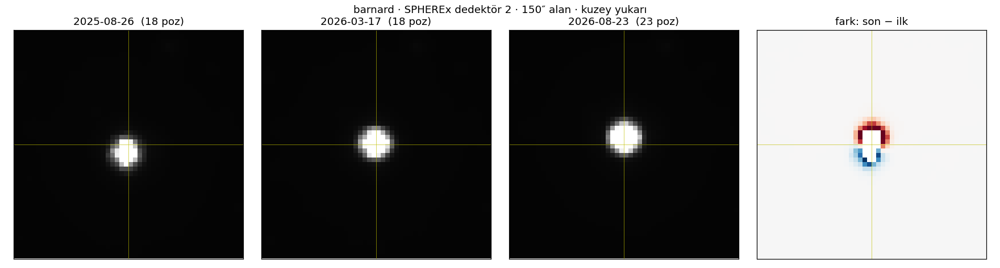

# SPHEREx Blink

A public web tool that plays NASA SPHEREx images of any patch of sky as a short
blink sequence, so anyone can spot objects that move or change brightness.

Built for the NASA Space Apps Challenge 2026, challenge
[Planet X and SPHEREx](https://www.spaceappschallenge.org/2026/challenges/planet-x-and-spherex/).

**Status:** work in progress. The data pipeline is proven; the website is being built.

## What works today

`proof/make_frames.py` finds every SPHEREx image covering a sky position, reads
small cutouts straight from the public AWS mirror, aligns them, groups them by
visit and stacks each visit.

Barnard's Star across three visits (detector 2). It moves about 10.6 arcseconds
north in one year:



```bash
python -m venv venv && source venv/bin/activate
pip install -r proof/requirements.txt
python proof/make_frames.py barnard 269.4462 4.7688 2 150
```

## Team

Working notes and per-role briefs (in Turkish) are in [`ekip/`](ekip/).
Start with `ekip/00_ORTAK_BAGLAM.md`.

## Data and acknowledgements

This project makes use of data products from the Spectro-Photometer for the
History of the Universe, Epoch of Reionization and Ices Explorer (SPHEREx),
which is a joint project of the Jet Propulsion Laboratory and the California
Institute of Technology, and is funded by the National Aeronautics and Space
Administration.

Data are served by the NASA/IPAC Infrared Science Archive (IRSA). AI assistance
(Claude) was used for code and documentation.
