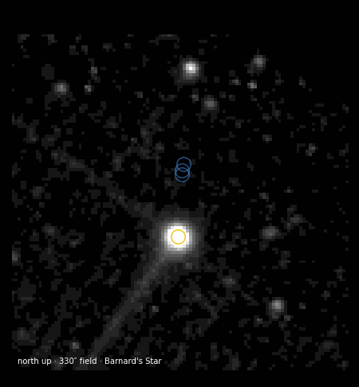
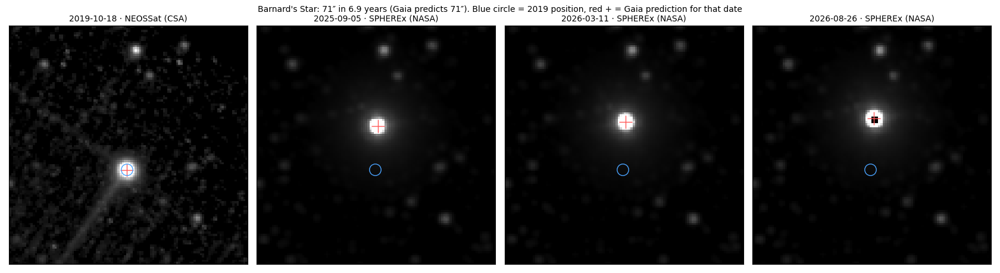

# Barnard's Star: NEOSSat 2019 → SPHEREx 2026

Two space telescopes from two agencies, almost seven years apart, on one grid.





## Result

| Date | Telescope | Offset from Gaia DR3 prediction |
|---|---|---|
| 2019-10-18 | NEOSSat (Canadian Space Agency), optical 0.4–0.9 µm | 0.73″ |
| 2025-09-05 | SPHEREx (NASA), detector 1, 0.75–1.09 µm | 0.50″ |
| 2026-03-11 | SPHEREx | 0.47″ |
| 2026-08-26 | SPHEREx | 0.78″ |

**Measured shift over 6.85 years: 71.2″ (10.39″/yr). Gaia DR3 predicts 71.2″ (10.39″/yr).**
Every position is within 1″ of the Gaia prediction, well below one pixel
(NEOSSat ~3″, SPHEREx ~6″). Numbers are in `out/barnard_neossat_spherex.json`.

## Method

1. `fetch_neossat.py` finds NEOSSat images whose target is Barnard's Star in the
   CADC archive (610 images, 13 Oct – 3 Dec 2019) and downloads the 55 frames of
   one night (2019-10-18, 1.1 s each, 24 MB) from CADC, which mirrors the CSA
   open data byte for byte (the CSA server is the fallback).
2. `solve_neossat.py` subtracts the overscan level, aligns and median-stacks the
   frames. NEOSSat frames have no sky solution, so it detects stars, matches 26 of
   them to Gaia DR3 (moved to 2019.80 with proper motion) and fits a TAN WCS:
   residual 0.63 px (~1.9″), pixel scale 2.99″. **Barnard's Star is excluded from
   the fit**, so its 2019 position is measured independently of Gaia.
3. `proof/make_frames.py` builds the SPHEREx visit stacks (detector 1, the band
   closest to NEOSSat's optical band; 59 exposures in 3 visits, 330″ field).
4. `compare.py` reprojects the NEOSSat stack onto the SPHEREx grid (north up,
   3″/px), centroids Barnard's Star in every frame, compares with Gaia DR3 and
   writes the GIF, the figure and the JSON.

```bash
pip install -r showcase/neossat_barnard/requirements.txt
python showcase/neossat_barnard/fetch_neossat.py cache/neossat_barnard
python showcase/neossat_barnard/solve_neossat.py cache/neossat_barnard showcase/neossat_barnard/out
python proof/make_frames.py barnard_wide 269.4470 4.7600 1 330
python showcase/neossat_barnard/compare.py showcase/neossat_barnard/out/neossat_stack.fits \
    proof/out/barnard_wide_D1.npy proof/out/barnard_wide_D1.json showcase/neossat_barnard/out
```

## Limitations

- This works for Barnard's Star only. In CADC, NEOSSat has no science images of
  the other four challenge targets (only a few dark frames near WISE 0855 and
  R Draconis). It is a showcase, not a general feature.
- Parallax (Barnard's Star: ±0.55″ over a year) is ignored; it may explain part
  of the 0.5–0.8″ residuals.
- The two telescopes see different colours (optical vs near-infrared) and have
  different pixel sizes, so the images do not look identical.
- The centre of Barnard's Star is saturated in the 2026-08-26 SPHEREx visit
  (dark spot); the centroid uses the surrounding pixels.

## Data and credits

- **SPHEREx** (NASA): data from the NASA/IPAC Infrared Science Archive (IRSA),
  read from the public AWS mirror. See the acknowledgement in the main README.
- **NEOSSat** (Canadian Space Agency): CSA open data,
  <https://data.asc-csa.gc.ca/dataset/neossat>; image list from the Canadian
  Astronomy Data Centre (CADC).
- **Gaia DR3** (European Space Agency): this work has made use of data from the
  ESA mission Gaia (<https://www.cosmos.esa.int/gaia>), processed by the Gaia Data
  Processing and Analysis Consortium (DPAC).
- Software: Astropy, reproject, NumPy, SciPy, Matplotlib, Pillow, Requests.
- AI use: the scripts and this README were written with an AI coding assistant
  and checked by running them end to end; the numbers above come from
  those runs.
